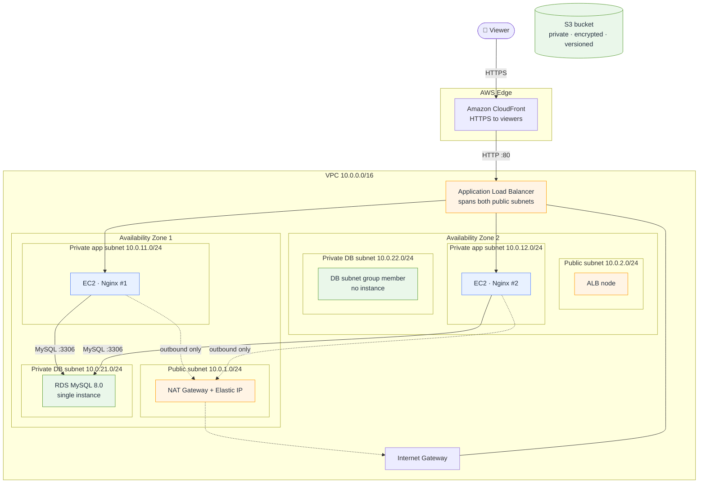
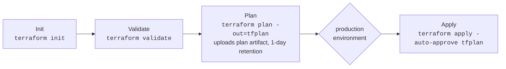

<div align="center">

# ☁️ AWS Three-Tier Architecture with Terraform

**Two Availability Zones. Private compute. Isolated data. Everything defined as code.**


</div>

---

## ✨ Overview

This project provisions a classic **three-tier web architecture** on AWS using modular Terraform. Viewers reach the application through **CloudFront**, traffic is balanced by a public **Application Load Balancer**, served by **Nginx on EC2 instances that have no public IP addresses**, and backed by a **private RDS MySQL** database.

What makes it worth reading:

- 🧱 **Modular IaC** — separate modules for `network`, `alb`, `ec2`, `rds`, `s3` and `cloudfront`, wired together in the root `main.tf`.
- 🔒 **Layered network boundaries** — public, application and database subnets, each with its own route table and chained security groups.
- 🔁 **Gated deployment** — a manually triggered GitHub Actions workflow that runs Init → Validate → Plan → Apply, with the apply job bound to a `production` environment.
- 💸 **Honest trade-offs** — cost and resilience decisions are documented rather than hidden.

> [!NOTE]
> This is a learning/portfolio-grade starter. It has **not** been load-tested or hardened for production, and this README makes no claims about deployment results.

---

## 🗺️ Architecture at a Glance

The VPC (`10.0.0.0/16`) spans **two Availability Zones** with six subnets: two public, two private application, and two private database.



**Reading the diagram**

- The **S3 bucket is standalone**: no module or resource connects it to CloudFront or the application tier in this code.
- **RDS has a single instance** (`multi_az = false`). The second DB subnet exists because a DB subnet group must span two AZs.
- The **NAT Gateway lives in public subnet 1** and serves both private app subnets through one shared route table.
- The **database route table has no default route**, so the DB tier has no path to the internet.
- The **ALB** is internet-facing and placed in both public subnets; its security group only admits CloudFront origin-facing addresses.

| Tier | Components | Subnets |
|------|-----------|---------|
| Edge | CloudFront (`PriceClass_100`, HTTP/2 and HTTP/3, IPv6) | — |
| Presentation | Internet-facing ALB, NAT Gateway | Public (`10.0.1.0/24`, `10.0.2.0/24`) |
| Application | 2 × `t3.micro` Amazon Linux 2023 running Nginx | Private app (`10.0.11.0/24`, `10.0.12.0/24`) |
| Data | RDS MySQL 8.0 `db.t3.micro`, 20 GB gp3 (autoscale to 50 GB) | Private DB (`10.0.21.0/24`, `10.0.22.0/24`) |

---

## 🚦 Request Journey

What happens when someone opens the CloudFront URL:

1. **Viewer → CloudFront.** The browser connects over HTTPS using the default `*.cloudfront.net` certificate. Plain HTTP requests are redirected to HTTPS (`redirect-to-https`).
2. **CloudFront → ALB.** CloudFront forwards the request to the ALB's DNS name over **HTTP on port 80**. TTLs are set to `0`, so responses are effectively not cached; query strings, all cookies, and the `Host`, `Authorization` and `Origin` headers are forwarded.
3. **ALB security group.** The ALB only accepts port 80 from the AWS-managed prefix list `com.amazonaws.global.cloudfront.origin-facing`.
4. **ALB → target group.** The HTTP listener forwards to a target group containing both EC2 instances. Health checks hit `/` and accept status codes `200-399`.
5. **EC2 (Nginx).** The instance security group only accepts port 80 **from the ALB's security group**. Nginx returns a static page written by `user_data`.
6. **EC2 → RDS (capability).** The database security group accepts port 3306 **only from the app security group**. The shipped Nginx page does not query the database; the path is provisioned and ready for application code.
7. **Outbound from the app tier.** Instances reach the internet (for example, to install packages) through the NAT Gateway; nothing on the internet can initiate a connection to them.

---

## 🧭 Architecture Decisions

### Implemented today

| Decision | What the code does | Why it matters |
|----------|-------------------|----------------|
| **Private application instances** | `associate_public_ip_address = false`, placed in private app subnets | No direct inbound path from the internet; the ALB is the only entry point. |
| **Security-group chaining** | CloudFront prefix list → ALB SG → App SG → RDS SG | Access is granted by *identity of the caller*, not by IP ranges that change. |
| **Database isolation** | `publicly_accessible = false`, dedicated subnets, route table without an internet route | The data tier is unreachable from outside the VPC. |
| **Single NAT Gateway** | One NAT + one EIP in public subnet 1, shared by both app subnets | Lowest-cost outbound path, at the price of resilience (see below). |
| **IMDSv2 enforced** | `http_tokens = "required"` on EC2 | Mitigates SSRF-style metadata credential theft. |
| **Encrypted storage** | Encrypted EBS root volumes, encrypted RDS storage, S3 SSE (AES256) | Data at rest is encrypted by default. |

### ⚖️ The single NAT Gateway trade-off

A NAT Gateway is a zonal resource. With one gateway in AZ 1:

- ✅ You pay for one gateway instead of two.
- ⚠️ If AZ 1 fails, the NAT Gateway goes with it, and instances in AZ 2 lose outbound internet access. Inbound traffic through the ALB would still be able to reach healthy instances, but anything needing outbound access (package installs, calls to external APIs) would fail.
- ⚠️ Traffic from AZ 2 crosses AZ boundaries to reach the NAT, which can add data-transfer charges.

### 🔭 Recommended future improvements (not implemented)

- One NAT Gateway and one private route table **per AZ**.
- Enable RDS **Multi-AZ**, a longer backup retention period, and `deletion_protection`, and take a final snapshot on destroy.
- Add a custom domain, an **ACM certificate**, and an HTTPS listener on the ALB; switch the CloudFront origin to HTTPS.
- Add an **Auto Scaling Group** instead of fixed `count = 2` instances.
- Add **AWS WAF** on CloudFront.
- Manage the RDS password with AWS Secrets Manager rather than a Terraform variable.
- Restrict security-group egress rules (currently allow-all).

---

## 🔐 Security

### Verified controls (from the code)

- **No public IPs on EC2**; app instances sit in private subnets.
- **ALB ingress limited to CloudFront** via the managed origin-facing prefix list, not `0.0.0.0/0`.
- **EC2 ingress limited to the ALB security group**; **RDS ingress limited to the app security group**.
- **RDS is not publicly accessible** and uses encrypted storage.
- **IMDSv2 required** on all instances.
- **S3**: all four Block Public Access settings enabled, SSE-S3 (AES256) encryption, versioning enabled, `force_destroy = false`.
- **Viewer traffic is HTTPS-only** at CloudFront (HTTP redirected).
- **Terraform state** is stored remotely in S3 with `encrypt = true` and native lockfile locking (`use_lockfile = true`) to prevent concurrent writes. The state bucket is referenced by `backend.tf` and is **not created by this project**, so it must already exist before `terraform init`.
- **`.gitignore`** excludes `.terraform/`, state files, plan files (`*.tfplan`), `terraform.tfvars`, `*.auto.tfvars`, `*.pem` and `.env`.

### Secrets handling

- `db_password` is declared `sensitive = true` and has **no default**. Supply it through the `TF_VAR_db_password` environment variable; never commit it.
- In CI, the password comes from the GitHub secret `TF_VAR_DB_PASSWORD`, and AWS credentials from the secrets `AWS_ACCESS_KEY_ID` and `AWS_SECRET_ACCESS_KEY`. No values appear in the repository.
- `terraform.tfvars.example` contains non-sensitive defaults only.

> [!WARNING]
> Terraform state and plan files can contain sensitive values, including the database password. Restrict access to the state bucket, and treat the plan artifact produced by the workflow as sensitive. Note that RDS `password` is stored in state in plaintext form.

### Known gaps

- CloudFront → ALB traffic is unencrypted HTTP (see [Cost Awareness](#-cost-awareness)).
- The workflow uses long-lived access keys; **OIDC federation** to an IAM role is the stronger pattern.
- Security-group egress is open to `0.0.0.0/0`.

---

## 🧰 Technology Stack

| Category | Technology |
|----------|-----------|
| Infrastructure as Code |   |
| Content delivery |  |
| Load balancing |  |
| Compute |    |
| Database |  |
| Storage |  |
| Networking |  |
| Automation |  |

---

## 🚀 Getting Started

### Prerequisites

- Terraform `>= 1.5.0` and AWS credentials configured for `us-east-1` (the default region).
- Access to the S3 state bucket named in `backend.tf`, **or** your own bucket: edit `backend.tf` before initializing.
- Windows PowerShell.

### 1. Provide the secret (current session only)

```powershell
$env:TF_VAR_db_password = "Use-A-Strong-Unique-Password-Here"
```

### 2. Initialize

Downloads providers and configures the S3 backend.

```powershell
terraform init
```

### 3. Format

```powershell
terraform fmt -recursive
```

### 4. Validate — checks syntax only

`validate` does not contact AWS to create anything and **creates no resources**.

```powershell
terraform validate
```

### 5. Plan — preview only

`plan` shows what *would* change and writes it to a file. **It does not create infrastructure.**

```powershell
terraform plan -out=tfplan
```

### 6. Review, then deploy — only when you are ready

Read the plan output carefully first. Applying **creates billable AWS resources**.

```powershell
terraform apply tfplan
```

### 7. Clean up the shell

```powershell
Remove-Item Env:TF_VAR_db_password
```

After a deployment, `terraform output` shows `cloudfront_url`, `alb_dns_name`, `ec2_private_ips`, `rds_endpoint` and `s3_bucket_name`.

> [!IMPORTANT]
> To avoid ongoing charges after experimenting, destroy resources deliberately with `terraform destroy` after reviewing what it will remove. Note that the RDS instance is configured with `skip_final_snapshot = true`, so no final snapshot is kept.

---

## 🔄 Terraform Workflow (GitHub Actions)

The workflow in `.github/workflows/terraform.yml` is named **Terraform Deploy** and runs **only on manual trigger** (`workflow_dispatch`). It uses `concurrency` (without cancelling in-progress runs) so two runs cannot deploy at the same time.



| Job | What it does |
|-----|-------------|
| **Init** | Checks out the code, sets up Terraform, configures AWS credentials, runs `terraform init`. |
| **Validate** | Re-initializes, then runs `terraform validate`. |
| **Plan** | Re-initializes, runs `terraform plan -out=tfplan -lock-timeout=60s` using the DB password secret, and uploads the plan as an artifact. |
| **Apply** | Runs in the `production` GitHub environment, downloads the saved plan and applies exactly that plan with `terraform apply -auto-approve -lock-timeout=60s tfplan`. |

Notes:

- `-auto-approve` here applies a **previously generated plan file**, so the apply matches what the plan produced.
- Each job runs on a fresh runner, which is why `terraform init` repeats.
- The `production` environment is where a **required-reviewer protection rule** can be configured in the repository settings. This README does not verify that such a rule is enabled; without one, the apply job proceeds automatically after Plan.
- No run history or pass/fail results are claimed here. Check the repository's **Actions** tab for actual runs.

---

## 💸 Cost Awareness

Deploying this stack **can incur AWS charges**. Review the plan and current AWS pricing first.

| Resource | Why it costs money |
|----------|-------------------|
| **NAT Gateway** | Hourly charge plus per-GB data processing, plus an Elastic IP. Often the largest line item in small stacks. |
| **Application Load Balancer** | Hourly charge plus load-balancer capacity units. |
| **EC2** | Two `t3.micro` instances, plus EBS storage (8 GB gp3 each). |
| **RDS** | A `db.t3.micro` instance, 20 GB gp3 storage (autoscaling up to 50 GB), and backup storage. |
| **CloudFront** | Per-request and data-transfer-out charges. |
| **S3** | Storage and requests (minimal in this project). |

Things to keep in mind:

- **One NAT Gateway reduces cost but is not fully AZ-resilient** (see [the trade-off](#️-the-single-nat-gateway-trade-off)).
- **CloudFront → ALB uses HTTP today.** Viewer traffic is HTTPS, but the origin leg inside AWS's network is unencrypted. The reason is that no domain name or ACM certificate is configured, and the default `*.cloudfront.net` certificate cannot be presented by an ALB. To fix it, register a domain, issue an ACM certificate in the ALB's region, add an HTTPS listener, and switch the CloudFront `origin_protocol_policy` to HTTPS.
- Free-tier eligibility depends on your account; do not assume it.

---

## 🗓️ Project Roadmap

### ✅ Completed (present in the code)

- [x] Modular VPC with public, app and database subnets across two AZs
- [x] Internet Gateway, single NAT Gateway, and per-tier route tables
- [x] Internet-facing ALB with health-checked target group
- [x] Two private Nginx EC2 instances bootstrapped by `user_data`
- [x] Private RDS MySQL with security-group-scoped access
- [x] Private, encrypted, versioned S3 bucket
- [x] CloudFront distribution in front of the ALB
- [x] Remote S3 state with encryption and lockfile
- [x] Manual GitHub Actions workflow: Init → Validate → Plan → Apply

### 🛠️ Planned (not implemented)

- [ ] HTTPS between CloudFront and the ALB (domain + ACM)
- [ ] One NAT Gateway per AZ
- [ ] RDS Multi-AZ and stronger backup/deletion settings
- [ ] Auto Scaling Group for the web tier
- [ ] OIDC authentication for GitHub Actions
- [ ] Secrets Manager for database credentials
- [ ] WAF, logging and monitoring

### ❓ Unverified

- Whether a full `apply` has been run against a live AWS account
- GitHub Actions run results
- Required-reviewer protection on the `production` environment
- Application-level connectivity from EC2 to RDS (the network path is provisioned; the sample page does not use it)

---

## 🎓 Lessons and Engineering Takeaways

- **Infrastructure as code** turns architecture into something reviewable: modules, plans and diffs replace console clicking.
- **Networking is the foundation.** Subnet design and route tables decide what is even *possible* before security groups decide what is *allowed*.
- **Trace the traffic.** Writing out the request path (CloudFront → ALB → EC2 → RDS) exposes gaps such as the HTTP origin leg.
- **Security boundaries compose.** Referencing security groups instead of CIDR blocks keeps rules tight as instances come and go.
- **Every saving is a trade-off.** The single NAT Gateway and single-AZ database are conscious cost choices, and naming them is part of the design.
- **Treat state and plans as sensitive.** Remote encrypted state, locking and ignored files are as much a part of the system as the VPC.
- **Separate "plan" from "apply."** Review gates and saved plans are what make automation safe.

---

<div align="center">

**Good cloud architecture isn't about how many services you use. It's about knowing exactly where every packet goes, and why.**

</div>
